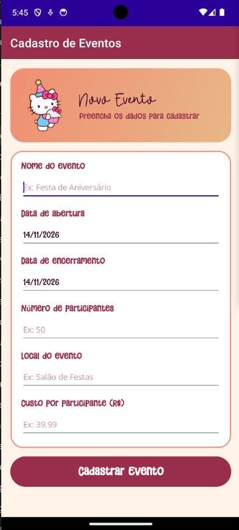

# 🎉 MauiAppEventos

Aplicativo mobile desenvolvido em **.NET MAUI** para realizar o cadastro de eventos e calcular automaticamente o custo total com base na quantidade de participantes. O usuário preenche os dados do evento, define as datas de abertura e encerramento, informa o público estimado e o valor por pessoa, e o app exibe o resumo formatado com o valor total.

Projeto da disciplina **Desenvolvimento de Sistemas II** (Agenda 15), com interface personalizada, paleta de cores temática e tipografia customizada (`GrapeSquishy`, `ClassicFairy` e `OpenSans`).

## ✨ Funcionalidades

* Preenchimento do nome e local do evento
* Seleção das datas de **abertura** e **encerramento** via `DatePicker`
* Definição da quantidade de participantes e do custo unitário por pessoa
* Cálculo automático do tempo de duração do evento (dias e horas)
* Resumo do evento: nome, local, datas, tempo de duração, participantes, valor por pessoa e **custo total**
* Botão para realizar um novo cadastro

## 📱 Telas

| Tela | Descrição | 
| ----- | ----- | 
| Cadastro de Eventos | Formulário para inserção dos dados, datas e custos do evento | 
| Resumo do Evento | Exibição formatada das informações cadastradas, duração e custo total | 

## 💰 Como o valor e o tempo são calculados

A duração do evento é calculada a partir da diferença entre a data de encerramento e a data de abertura, enquanto o custo total multiplica o número de participantes pelo custo individual:

```
Tempo de duração = Data de encerramento - Data de abertura
Custo total      = Número de participantes × Custo por participante
```

## 🛠️ Tecnologias

* [.NET 8](https://dotnet.microsoft.com/)
* .NET MAUI (C# e XAML)
* Navegação entre páginas com `NavigationPage` e vinculação de dados (*Data Binding*)

## 📂 Estrutura do projeto

```
MauiAppEventos/
├── models/          # Modelo de dados e regras de cálculo do evento
├── Views/           # Telas de Cadastro e Resumo do Evento (.xaml e .cs)
├── Resources/       # Fontes personalizadas e imagens temáticas
└── MauiProgram.cs   # Configuração inicial e registro das fontes
```

## ▶️ Como executar

### No Windows (Visual Studio 2022)

1. Instale o Visual Studio 2022 com a carga de trabalho **Desenvolvimento para dispositivos móveis com .NET (MAUI)**.
2. Abra o arquivo `MauiAppEventos.sln`.
3. Escolha o destino (emulador Android ou Windows Machine) e pressione **F5**.

### No Linux (somente Android)

Requisitos: .NET 8 SDK, JDK 17, workload `maui-android` e Android SDK.

```bash
dotnet workload install maui-android
```

No Linux, o `.csproj` precisa ter apenas o alvo Android. Em `TargetFrameworks`, deixe:

```xml
<TargetFrameworks>net8.0-android</TargetFrameworks>
```

Com um emulador ou celular conectado (`adb devices`), execute dentro da pasta `MauiAppEventos`:

```bash
dotnet build -t:Run -f net8.0-android \
  -p:AndroidSdkDirectory=$HOME/Android/Sdk \
  -p:JavaSdkDirectory=$JAVA_HOME
```

## 🖼️ Capturas de tela

| Cadastro de Eventos | Resumo do Evento | 
| :---: | :---: | 
|  |  | 

## 👩‍💻 Desenvolvedora

**Adrielle Maciel de Sena** — 2026# Adrielle_Agenda15_DS_II
